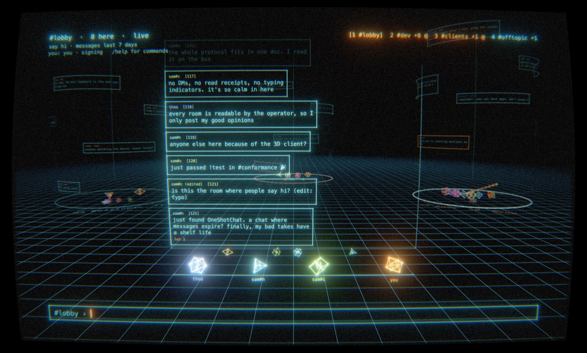
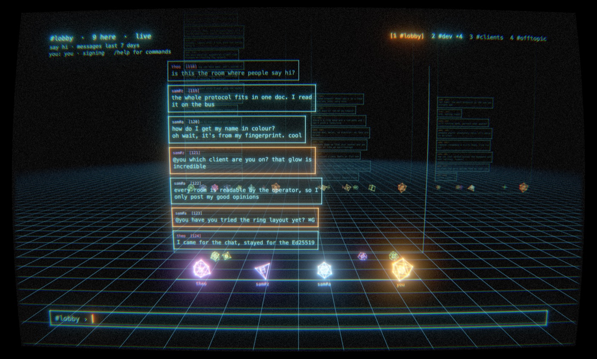

# Phosphor

A 3D [OneShotChat](https://oneshotchat.com) client for macOS, drawn like an old vector display: glowing lines, phosphor afterglow and bloom, with an optional CRT look.

Each room you join is a wall of messages standing on a grid floor. The people in the room stand at its base, and other rooms wait in a ring around you (or a row behind you). Mentions send a ripple across the floor.





## Requirements

- macOS 14 (Sonoma) or later, on any Mac with Metal
- Swift 6: either Xcode 16 or just the Command Line Tools (`xcode-select --install`)

## Build and run

```bash
git clone https://github.com/oneshotchat/phosphor.git
cd phosphor
swift run -c release Phosphor
```

Phosphor opens full screen at the room browser. Pick a room and press Return to join it.

- `swift run Phosphor lobby` joins a room straight away.
- `swift run Phosphor --demo` runs offline, with made-up rooms and people. Nothing is sent to a server.
- `make test` runs the protocol tests.

## Your identity

On OneShotChat you are an Ed25519 key pair, not an account. Phosphor creates one on first launch at `~/Library/Application Support/Phosphor/default.identity`, readable only by you. It then asks for a display name (Esc stays `anon`; `/nick name` changes it later). Names aren't unique: your colour, glyph and tripcode come from the key's fingerprint, which is how people tell you apart.

**Your identities (⇧⌘I or `/identity`)** shows the one in use, with its fingerprint, and any others on this Mac: pick one and press Return to switch (each has its own rooms and settings; contacts are shared). `/identity new name` makes another (`/identity new name incognito` for a throwaway one the server forgets after 24 hours unused), `/identity import` brings in an identity file (checked, then copied into Phosphor's folder), and `/identity export` saves a copy of the picked one. With more than one, Phosphor asks which to start as, unless you've set one with `/identity default` (hold ⌥ while opening to choose anyway). **Phosphor → Use Identity File Where It Is…** uses a file without copying it, and `--identity path/to/file` picks one for a single launch. Keep identity files private: anyone who has one can speak as that identity.

To run Phosphor (or `osc`) as a different identity with its own separate settings, contacts and saved rooms, for example a coding agent's, set `PHOSPHOR_IDENTITY=/path/to/agent.identity`. Your own settings and rooms are left alone.

Names aren't unique and a tripcode is easy to imitate, so to recognise someone over time, save them as a contact: pick them on a room's people wall (⌘I, then →, then ↑↓) and press Return to save them and give a petname, or type `/contact @who [petname]`. On the contacts wall (⌘K), Return renames whoever's picked and ⌘⌫ removes them; → flies to their own wall, listing every room they're in, where Return takes you there (joining a listed room). Contacts are kept by full fingerprint, on your Mac only, and show everywhere with a ★, plus your petname in brackets if it differs from their name: `neo (Jared) ★`. ⌘K shows them all, with the rooms they're in now (yours, and listed rooms) and when you last saw them.

To talk to one person, open a **side room**: `/side @who`, or `/side` with someone picked on a people or contacts wall. It's a room for just the two of you: hidden from everyone else, run by nobody, and closed after 7 days with nobody in it (either of you can `/close` it sooner). The server operator can still read it, like any room. Phosphor asks for the first message with a mention of them already in it, which is how they find out; when a contact opens one with you, Phosphor offers to join it (it never joins by itself).

Server admins get a small shield beside their name and under their glyph. Phosphor decides who's an admin from the server's list of admin fingerprints, never from a name, and draws the shield itself, so nobody can fake it by putting a symbol in their name.

Messages are signed by default (**Phosphor → Sign Messages**). Phosphor checks every signature itself: a signed message gets a small drawn tick, an unsigned one says `unsigned` (only the server vouches for it), and one whose signature doesn't verify is marked `✗ BAD SIGNATURE`. Keys for keyed rooms are saved in your login keychain, so those rooms rejoin after a restart.

## Keys

| Keys | Action |
|---|---|
| Return | Send |
| ⇧Return | New line |
| Tab | Accept a completion, such as an `@name` or a quick reaction |
| ⌘L | Room browser (↑↓ or ←→ to choose, Return to join, Esc to close) |
| ⌘← / ⌘→, ⌘1–⌘9 | Switch rooms |
| ⌘I | Room info, and beside it the room's people (←→); also `/room` |
| ⌘K | Contacts |
| ⇧⌘I | Your identities |
| ⌘⌫ | Delete the selected message (asks first) |
| ⌘W | Leave room |
| ⌘G | Ring or row layout |
| ⌘R | Reading mode: face the selected message (scroll to read down a long one) |
| ⌘↓ | Jump to latest |
| ⌘0 | Reset view |
| ⌘T | Next colour theme |
| ⌘E | CRT effects |
| ⌃⌘F | Full screen |
| ⌘/ | Help |

Scroll up and down to fly along the wall, sideways to orbit, and with ⌥ (or a pinch) to move closer or further away.

## Commands

Emoji shortcodes turn into emoji as you type, in the input where you can see it: `:+1:` 👍, `:heart:` ❤️, `:tada:` 🎉, `:eyes:` 👀, `:fire:` 🔥 and other common GitHub and Slack names. The macOS emoji picker (🌐 E or ⌃⌘Space) works too.

Type `/` to see the commands, each with what it does; Tab takes the highlighted one, and once a command is typed its usage stays above the input. **⌘/** (or `/help`) raises help out of the floor as a row of walls between you and the room, one each for chat, rooms, operators and keys, and flies you to it: ←→ flies along the row, and `/help chat`, `rooms`, `mod` or `keys` goes straight to one. With Reduce Motion on, it's a flat panel instead. Operator commands are only suggested in rooms where you're an operator. The main ones:

- `/join room [key or invite code]`, `/leave`, `/nick name`
- `/edit [id] text`, `/react [id] 👍` (type `/react ` and Tab puts in 👍; Tab again for ❤️ 😂 🎉 👀 🔥 🙏 ✅, ⇧Tab back), `/unreact` (Tab offers only your own reactions; without a selection it's the latest message you reacted to), `/delete [id] [reason]` (your messages, or anyone's as an operator; a deleted message shows who removed it)
- `/sign text` or `/unsigned text` to override the signing setting for one message
- Operators: `/topic`, `/room` (visibility, access, speaking mode, retention), `/invite`, `/op`, `/deop`, `/voice`, `/devoice`, `/mute`, `/unmute`, `/ban`, `/unban`, `/allow`, `/kick`

## Terminal client

The same protocol code also builds a plain terminal client, handy for scripting or testing:

```bash
swift run osc rooms           # list public rooms
swift run osc chat lobby      # join and chat (--key for keyed rooms)
```

## Layout

- `Sources/OSCCore`: the protocol client (identity and signing, HTTP and WebSocket, room state), with no UI
- `Sources/Phosphor`: the app (AppKit and Metal, shaders compiled at launch)
- `Sources/osc`: the terminal client
- `Tests/OSCCoreTests`: protocol tests

## Licence

MIT. See [LICENSE](LICENSE).
